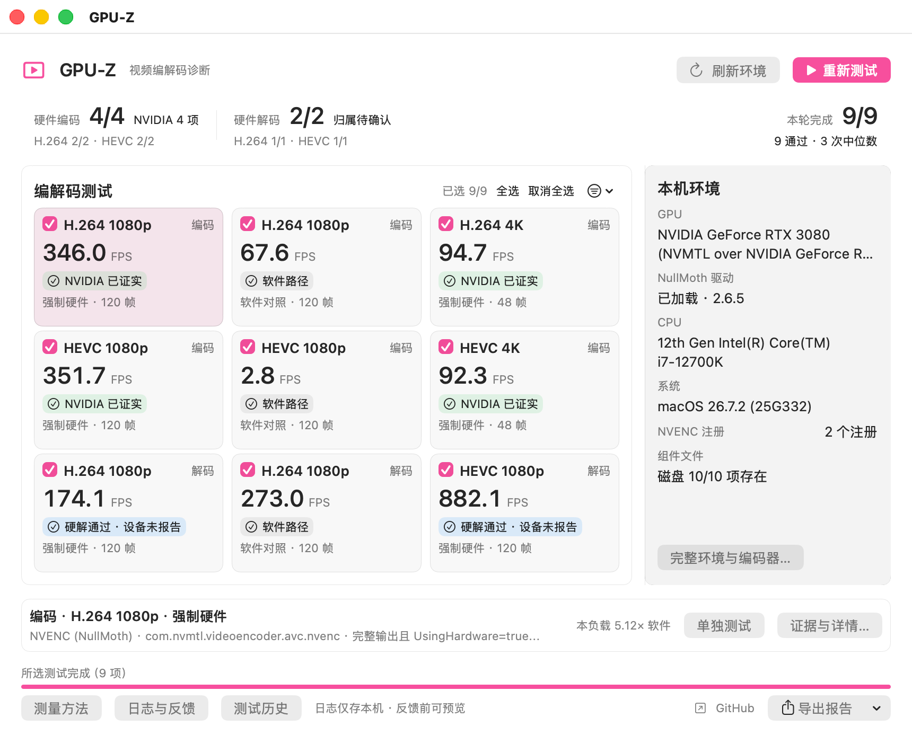
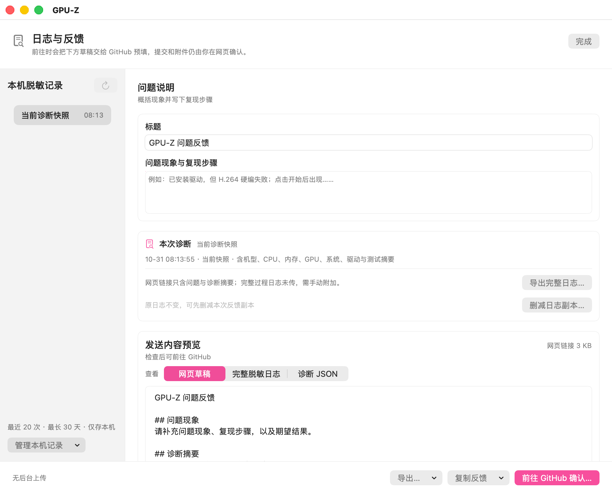

# GPU-Z

给黑苹果 NVIDIA 显卡测一测 H.264 / HEVC 硬编、硬解，也能看看 NullMoth 驱动有没有正常加载。源码仓库仍叫 NVCodecTest。

**[下载与版本说明](https://github.com/GeekAudio/NVCodecTest/releases)**

v1.6.1 统一整理了历史、详情、测量方法、环境和日志反馈页，补上列表悬停与选中反馈，并统一分类、统计、导出和反馈的成绩判断。自选测试、单项测试和自动更新继续保留；下载入口仍指向原有 NVCodecTest Releases。

应用继续使用原 bundle identifier 和 `~/Library/Application Support/NVCodecTest/Diagnostics` 日志目录，因此升级后仍能查看既有本机记录。主窗口保留九项测试卡片与本机环境栏；完整证据、测量方法、日志与反馈使用弹窗。



主界面和反馈页图片重放已保存的脱敏报告，没有为截图重跑显卡负载。

## 怎么用

下载 DMG，把 App 拖进“应用程序”，打开后点“开始测试”。软件 HEVC 比较慢，整轮可能要几分钟，也可以中途取消。

九宫格默认全选。卡片左上角可逐项勾选，也能点“全选”“取消全选”，或按硬件、软件、编码、解码批量选择。点卡片后，用下方“单独测试”只运行这一项；右键菜单也能单跑。每轮重新记录结果，进度和报告按本轮范围统计，未选择的项目不会算作失败。单跑解码时会用软件准备输入素材，这一步属于解码准备，不另算一项编码测试；软件 HEVC 素材准备可能需要一些时间。

启动时会检查 GitHub 正式新版，提供“更新”“跳过此版本”；也可从 GPU-Z 菜单手动“检查更新…”。下载显示实际进度，校验后安装并重启；跳过只影响该版本。自动更新需要把应用放在可写的“应用程序”目录，测试过程中不会开始安装。

底部“测试历史”用一张总表展示所有已保存测试：每轮一行，九项测试各占一列，直接查看各轮 FPS 和状态。鼠标悬停会提示所在行与成绩，点击成绩查看单项详情，返回后保留位置标记。不同输入、设备或测试条件下的数值不代表性能变化。历史沿用本机诊断日志的保留范围（最近 20 条记录、30 天、合计不超过 20 MiB），只读查看，不会上传。

首次被系统拦住，先关闭提示，再到“系统设置 → 隐私与安全性”点“仍要打开”。

- **NVIDIA 已证实**：完整输出、硬件属性和 NVIDIA 身份证据都对上了。
- **系统硬件 · GPU 未确认**：硬件测试通过了，但驱动没给足设备信息，不代表硬解失败。
- **失败、未验证、未测试、已取消**：各自保留原因，不会都说成“驱动没装”。

右侧显示 GPU、驱动与系统摘要；点“完整环境与编码器…”查看安装版本、实际加载版本和编码器注册。选中九宫格中的一张卡片，再点“证据与详情…”查看完整依据。支持 TXT / JSON 报告和同负载软硬件吞吐对照。程序不改系统配置或 EFI，不安装驱动，不需要 root。

默认窗口 860 × 670，最小 840 × 660。主界面只有一个页面，所有九项在默认大小和最小大小下均完整显示。Command-Return 开始测试，Command-. 请求安全取消。退出时也会先请求取消并等待当前驱动调用返回。macOS 11 起与 Intel / Apple Silicon 通用架构支持保留。原生令牌、层次、兼容写法与实测对比度见 [界面规范](docs/macOS原生界面规范.md)。

## 发日志帮忙改进

点窗口底部的“日志与反馈”，选一轮记录，写下遇到的现象，再预览准备提交的内容。可以先“删减日志副本”，去掉不想公开的部分。点“前往 GitHub 确认”后会打开网页草稿，需要登录自己的 GitHub 账号并确认提交。

软件会自动保存本机环境、测试阶段、错误和结果；取消或异常退出也会留下已完成的记录。最多保留最近 20 次、30 天，合计不超过 20 MiB，可以在软件里删除。

反馈默认带上机型、CPU、内存、GPU、系统及驱动版本，以及本轮测试和错误日志摘要。机型是系统报告的 SMBIOS 名称，黑苹果可能自行配置。引导参数只保留白名单诊断开关，用户路径和常见身份信息会先隐藏。请在提交前再检查一遍，GitHub Issue 是公开的。完整过程日志太长时，软件会提示复制完整草稿或导出日志，在网页粘贴或添加附件。打开网页会把预览的草稿传给 GitHub 用于预填，不会自动创建 Issue 或附加文件，也不需要给软件配置 Token。

本地日志在 `~/Library/Application Support/NVCodecTest/Diagnostics`。普通“导出报告”保留完整诊断内容，反馈请使用“日志与反馈”中的脱敏版本。没有后台回传或自动上传。



## 自己编译

需要 macOS 11 或更新版本，以及 Xcode Command Line Tools。在仓库目录运行：

```bash
./build.sh       # 生成 build/GPU-Z.app（可执行文件仍为 NVCodecTest）
./package.sh     # 生成 DMG

./Tests/run-env-probe-tests.sh
./Tests/run-result-semantics-tests.sh
./Tests/run-diagnostic-feedback-tests.sh
./Tests/run-source-contract-tests.sh
./Tests/run-worker-tests.sh
./Tests/run-session-evidence-tests.sh
./Tests/run-selection-model-tests.sh
./Tests/run-app-update-tests.sh
```

App 包含 Intel 和 Apple Silicon 两种架构。NVIDIA / NullMoth 检测主要给 Intel 黑苹果用；Apple Silicon 可以测系统编解码器作为对照。

命令行也能用：

```bash
./build/GPU-Z.app/Contents/MacOS/NVCodecTest --diagnose --output /tmp/nvcodec-env.json
./build/GPU-Z.app/Contents/MacOS/NVCodecTest --selftest --output /tmp/nvcodec-test.txt --json-output /tmp/nvcodec-test.json
```

也可以用 `--preview --results-json <已有报告>` 打开真实窗口查看已保存结果，不重新运行 GPU 测试。

## 测法说明

检测规则按 NullMoth v2.6.2 源码与 Apple API 核对，新增 GPU profile、视频开关、实际载入的视频库和组件文件存在性。测量独立运行，日志与界面在父进程处理；父进程保留驱动错误输出。具体依据和实体/合成测试的边界见 [源码对齐与验证范围](docs/源码对齐与验证范围.md)。

使用 Apple VideoToolbox 官方 API，检查真实输出、完整帧数和实际硬件属性。编码和解码先预热，再测三次取中位数。缺一个版本文件不会直接判定驱动没装，安装版本与加载版本也会分开记录。

本机已运行独立进程的完整九项矩阵（含软件对照），另有驱动规则、结果语义、进程协议及日志逻辑检查。实测会如实记录当前驱动的成功或错误；其他电脑还需要实际验证。

这是诊断工具，FPS 是固定合成负载的结果，不是 Apple / NVIDIA 认证跑分，也不是等画质比较。具体参数、判断依据和限制见 [检测方法](docs/检测方法.md)。

[MIT](LICENSE)
